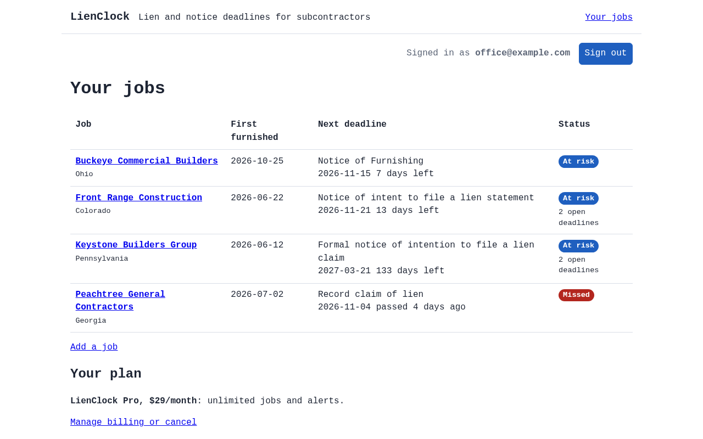
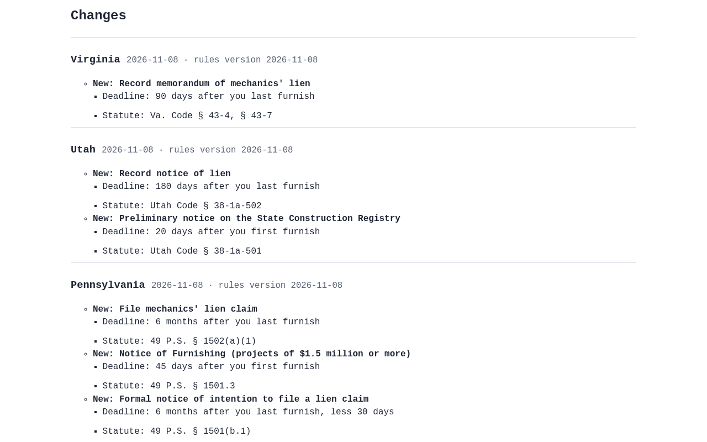
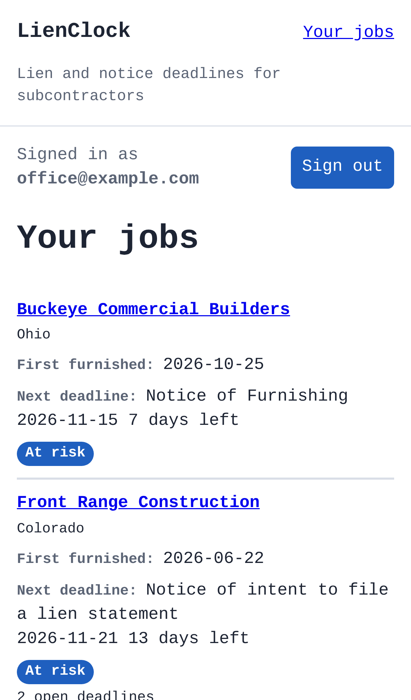
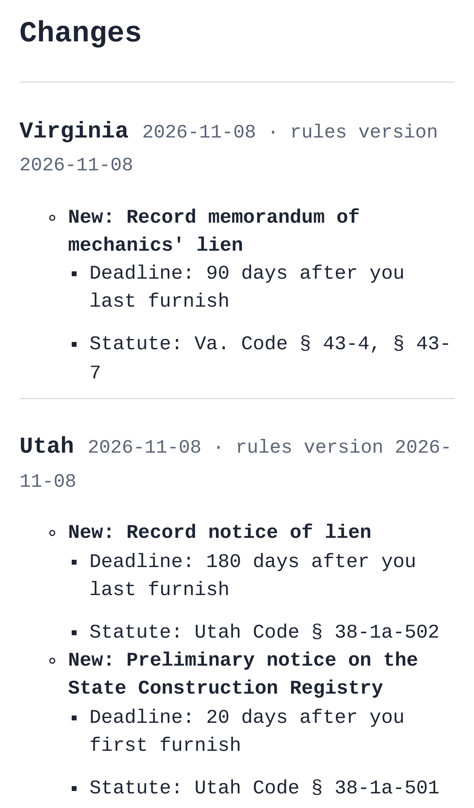

# lienclock — lien and preliminary-notice deadline tracker for small subcontractors

## Screenshots

The calculator's result for a Pennsylvania job (a state added in M3): the notice of intent ("6 months less 30 days"), the lien claim and a missed Notice of Furnishing, each with its statute and last-verified date. Below is the Free / Pro $29/month pricing.

After signing up through the emailed link, hitting the Free plan's 1-job limit and paying (a signed Stripe `checkout.session.completed` webhook): the account is on LienClock Pro, with jobs in Ohio, Colorado, Pennsylvania and Georgia, most urgent first.

The changelog the daily cron recorded on its first run: every rule added since the M1 rules, per state, with deadline and statute. Changed rules show before → after, and their owners get an email.

The same deadlines on an iPhone 13, one labelled card per deadline.

The signed-in dashboard on a phone, with each job's state, first-furnish date, next deadline and status.

The rules changelog on a phone.

_All data is made up. Regenerate with `npm run screenshots` (needs `CHROMIUM_PATH`, see [Build notes](BUILD.md))._

For owners of small specialty subcontractors working across states, it computes each job's preliminary-notice and lien-filing deadlines and alerts them before they lapse, at a flat price instead of $19 per notice or $149/month platforms.

Now: 16 states (CA, TX, FL, WA, AZ, NV, CO, GA, IL, MN, NJ, NY, OH, PA, UT, VA), passwordless accounts, email alerts, a calendar feed, email-forward intake, a rules changelog that emails the people affected, and LienClock Pro at $29/month through a Stripe Payment Link (Free: 1 tracked job).

- [Research](RESEARCH.md) — findings and sources
- [PRD](PRD.md)
- [Roadmap](ROADMAP.md)
- [Build notes](BUILD.md): what works now, how to run, test and deploy it

Effort: Medium · Confidence: Low

_Researched by the idea pipeline on 2026-10-11 ([original record](https://github.com/smithdavedesign/idea-factory/tree/main/ideas/lienclock)); repo created on David's go-ahead 2026-10-11._
