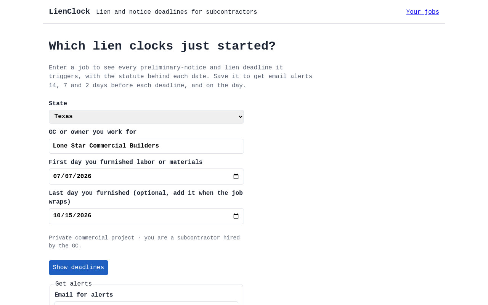
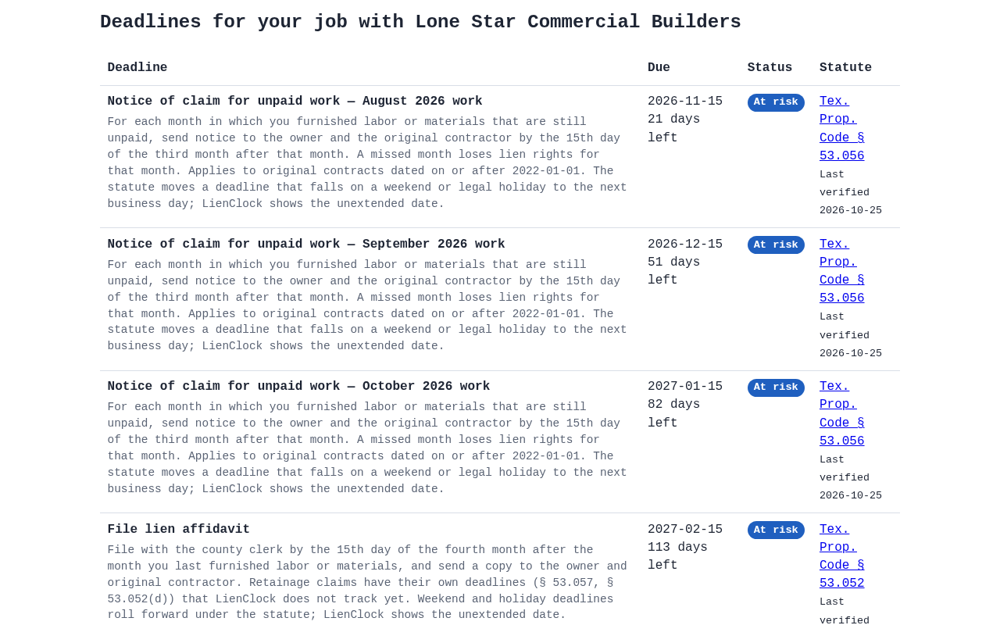
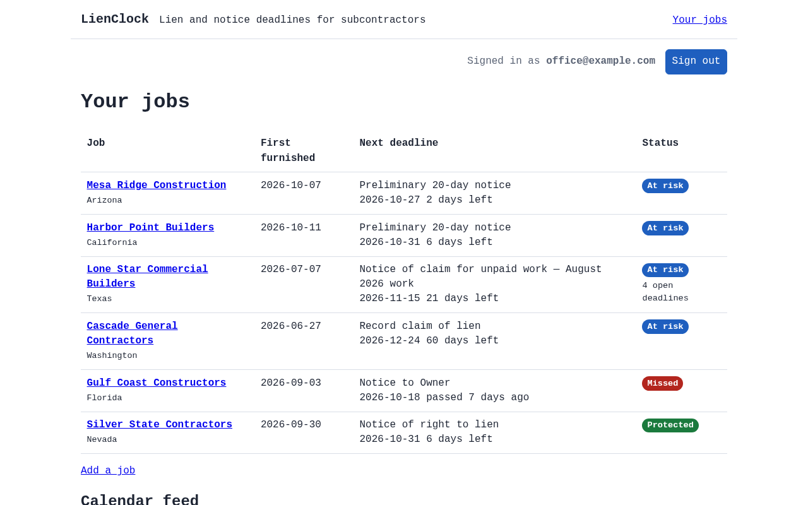
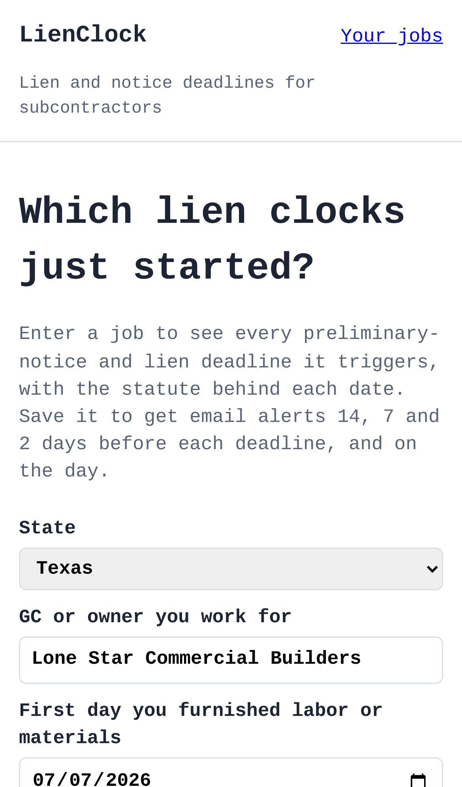
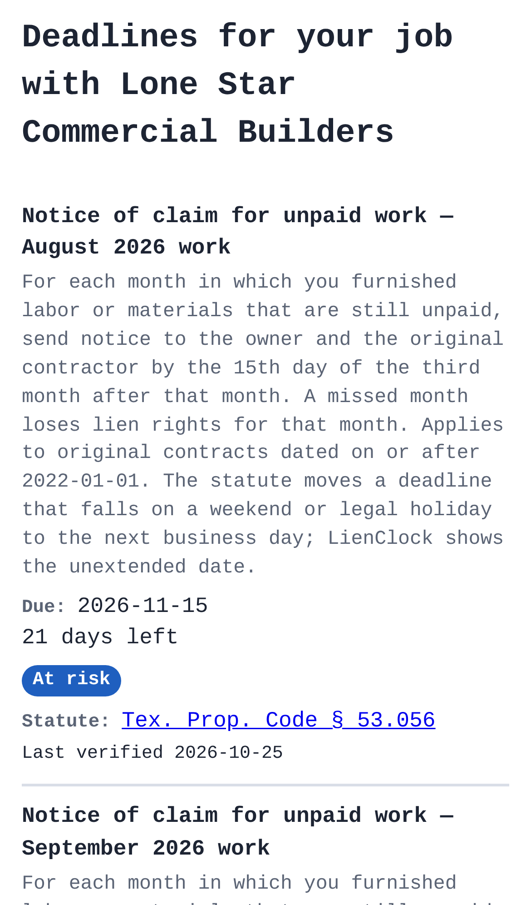
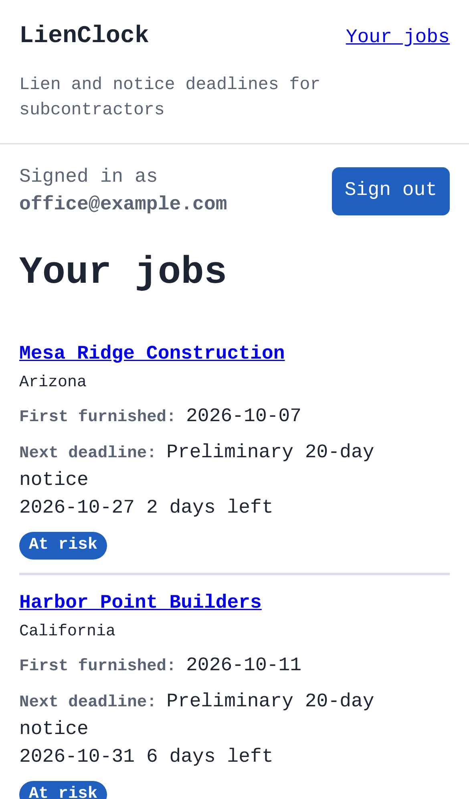

# lienclock — lien and preliminary-notice deadline tracker for small subcontractors

## Screenshots

The start page: a sample Texas job (state, GC, first and last furnishing dates) entered in the deadline calculator.

The result: each month-by-month notice of claim and the lien affidavit, with due date, days left, status and the statute behind it.

After signing in through the emailed link, six saved jobs across six states, most urgent first, marked at risk, missed or protected.

The same start page on an iPhone 13.

The same deadlines on a phone, one labelled card per deadline.

The signed-in dashboard on a phone, with each job's first-furnish date, next deadline and status.

_All data is made up. Regenerate with `npm run screenshots` (needs `CHROMIUM_PATH`, see [Build notes](BUILD.md))._

For owners of small specialty subcontractors working across states, it computes each job's preliminary-notice and lien-filing deadlines and alerts them before they lapse, at a flat price instead of $19 per notice or $149/month platforms.

- [Research](RESEARCH.md) — findings and sources
- [PRD](PRD.md)
- [Roadmap](ROADMAP.md)
- [Build notes](BUILD.md): what works now, how to run, test and deploy it

Effort: Medium · Confidence: Low

_Researched by the idea pipeline on 2026-10-11 ([original record](https://github.com/smithdavedesign/idea-factory/tree/main/ideas/lienclock)); repo created on David's go-ahead 2026-10-11._
