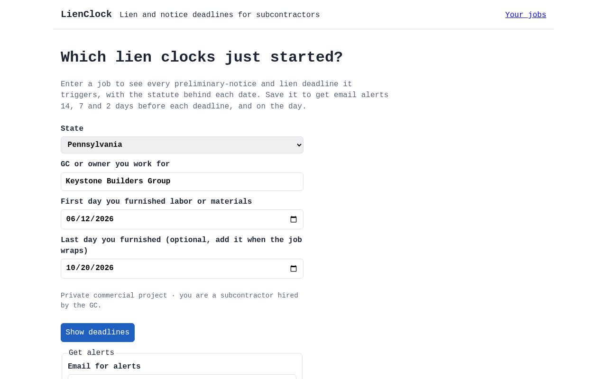
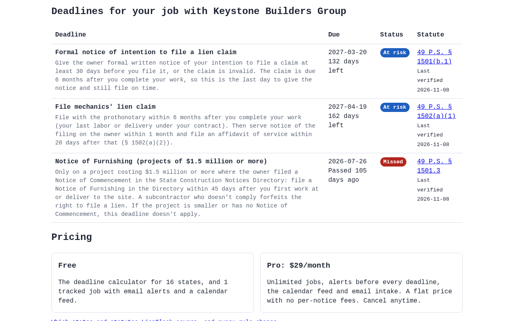
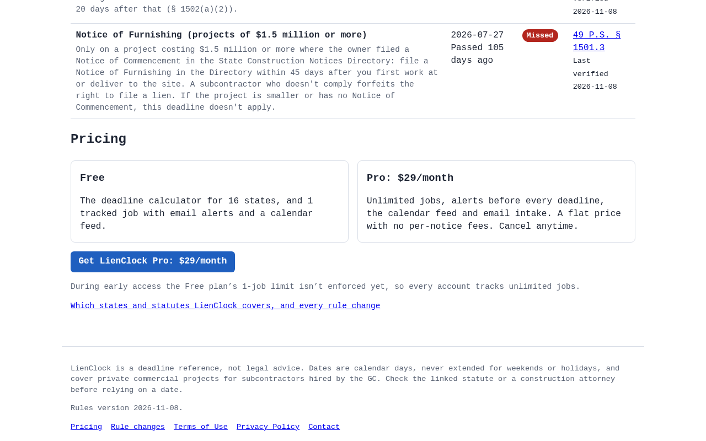
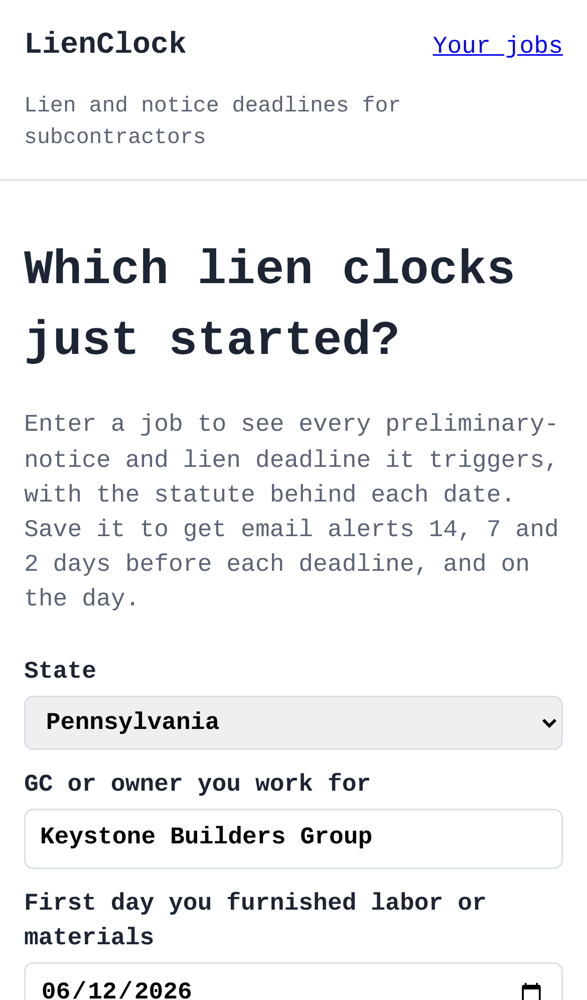
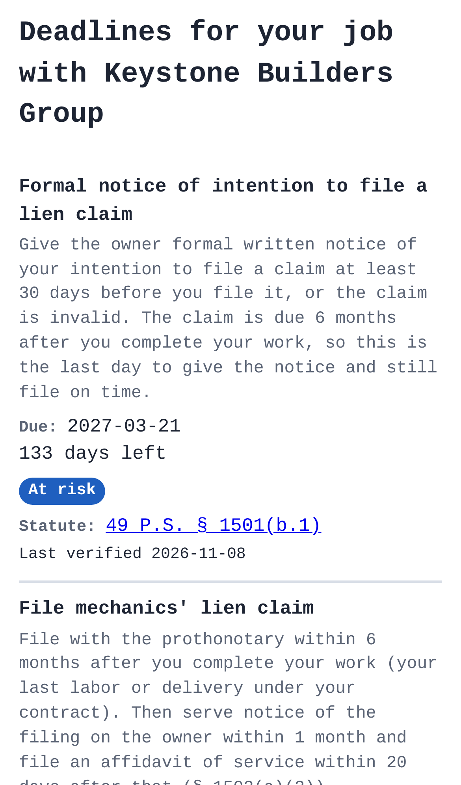
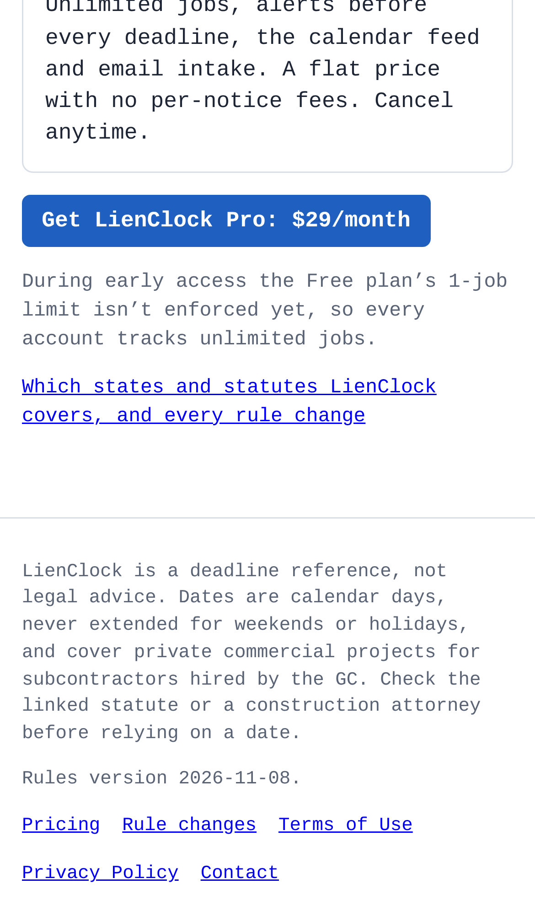

# lienclock — lien and preliminary-notice deadline tracker for small subcontractors

## Screenshots

The start page (`/`) of the production build, with a sample job filled in: state, GC and furnishing dates. This is the core action, one click from its result.

The result: the notice of intent, the lien claim and a missed Notice of Furnishing, each with its due date, status, statute and last-verified date.

Proves the site is ready to launch. The "Get LienClock Pro: $29/month" button links to `STRIPE_PAYMENT_LINK` (a placeholder in this run), and the footer links to Pricing, Rule changes, Terms of Use, Privacy Policy and Contact (GitHub issues).

The same start page on an iPhone 13.

The result on a phone: one labelled card per deadline.

The Get Pro button and the footer links on a phone.

_All data is made up. The run checks that the visit beacon sent nothing (automated browser, not a production build). Regenerate with `npm run screenshots` (needs `CHROMIUM_PATH`, see [Build notes](BUILD.md))._

For owners of small specialty subcontractors working across states, it computes each job's preliminary-notice and lien-filing deadlines and alerts them before they lapse, at a flat price instead of $19 per notice or $149/month platforms.

Now: 16 states (CA, TX, FL, WA, AZ, NV, CO, GA, IL, MN, NJ, NY, OH, PA, UT, VA), passwordless accounts, email alerts, a calendar feed, email-forward intake, a rules changelog that emails the people affected, and LienClock Pro at $29/month through a Stripe Payment Link (Free: 1 tracked job).

- [Research](RESEARCH.md) — findings and sources
- [PRD](PRD.md)
- [Roadmap](ROADMAP.md)
- [Build notes](BUILD.md): what works now, how to run, test and deploy it
- [Launch readiness](LAUNCH-READY.md): search tags, legal pages, the Get Pro button, the visit beacon, hosting on Cloudflare Workers, and what's left before launch

Effort: Medium · Confidence: Low

_Researched by the idea pipeline on 2026-10-11 ([original record](https://github.com/smithdavedesign/idea-factory/tree/main/ideas/lienclock)); repo created on David's go-ahead 2026-10-11._
